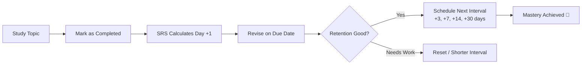

# 🎯 GATE Revision Tracker (CS & IT)

[](https://react.dev/)
[](https://www.typescriptlang.org/)
[](https://vite.dev/)
[](https://tailwindcss.com/)
[](#-privacy--local-first)
[](LICENSE)

> A high-performance, distraction-free study companion and automated **Spaced Repetition System (SRS)** built specifically for **GATE Computer Science & Information Technology** aspirants.

---

## 💡 Why GATE Revision Tracker?

Preparing for the **GATE CS exam** is notoriously challenging. The syllabus spans **11 vast subjects** and over **170 individual topics**. The biggest hurdle isn't just studying — it's **retention**. According to the Ebbinghaus Forgetting Curve, without timely review, students forget up to 70% of what they learned within a week.

Most aspirants track their preparation using static spreadsheets, paper checklists, or generic habit trackers that don't automate revision schedules.

**GATE Revision Tracker solves this by providing:**
- 📚 **A ready-to-use, preloaded GATE CS syllabus** with 170+ topics organized by standard exam weightage.
- 🔄 **An intelligent Spaced Repetition engine** that automatically schedules review intervals (1, 3, 7, 14, 30 days) whenever you finish a topic.
- 🟩 **A GitHub-style 20-week study activity heatmap** and daily streak tracker to keep you consistent.
- 🔒 **100% privacy and local-first architecture** — no login, no accounts, no servers. All your data stays in your browser's local storage with instant JSON backup/restore.

---

## ✨ Key Features

### 1. 📖 Full Preloaded GATE CS/IT Syllabus Matrix
- Pre-populated with **all 11 core GATE CS subjects** broken down into chapters and 170 atomic topics.
- Reflects historical GATE marks weightage to help prioritize high-yield areas.
- Topic status indicators: `Not Started`, `In Progress`, and `Completed`.
- Granular confidence self-assessment: `Weak`, `Average`, `Good`, or `Strong`.
- Priority tags: `Critical`, `High`, `Medium`, and `Low`.
- Personal topic notes and timestamped revision logs.
- Bulk chapter actions (e.g., mark entire chapter complete or reset).

### 2. 🧠 Smart Spaced Repetition (SRS) Queue
- Automatically calculates the exact date for your next review after you complete or revise any topic.
- Default scientific intervals: **Day +1 ➔ Day +3 ➔ Day +7 ➔ Day +14 ➔ Day +30** (fully customizable in Settings).
- Categorized queues:
  - 🚨 **Overdue Revisions**: Missed reviews that need urgent attention.
  - 📅 **Due Today**: Scheduled reviews for the current study session.
  - 🔮 **Upcoming Revisions**: Future scheduled reviews.
- 1-click revision logging with confidence level adjustments and quick snooze/postpone options (`+1 day`, `+3 days`, `+7 days`).

### 3. 🟩 GitHub-Style Study Activity Heatmap & Streaks
- Visual 20-week study activity grid showing your daily consistency.
- Four intensity levels based on topics completed and revised each day.
- Daily streak counter with flame milestones and XP gamification.
- Daily target progress bar (configurable target, e.g., 3 topics/day).

### 4. 📅 Interactive Study Calendar
- Full monthly calendar displaying scheduled revisions and completed topics.
- Color-coded badges by subject to balance your daily study load.
- Day-by-day topic inspector to quickly view what is due on any chosen date.

### 5. 📊 Deep Analytics & Performance Insights
- **Overall Syllabus Progress**: Percentage of completion across the entire syllabus.
- **Subject-by-Subject Breakdown**: Progress bars and topic counts for each subject.
- **Confidence Health Check**: Visual distribution of your grasp (`Weak` vs `Good` vs `Strong`).
- **High-Priority Coverage**: Tracks your readiness in critical, high-weightage topics.

### 6. ⚡ Power-User Productivity Tools
- **Command Palette (`Ctrl + K` or `Cmd + K`)**: Instant search and direct navigation across all 170 topics, subjects, and actions.
- **Dynamic Island HUD**: Floating pill displaying countdown to the GATE exam, daily goal progress, and milestone toasts.
- **Undo Toast**: Made a mistake or accidentally checked a box? Undo it instantly in one click.
- **Audio Feedback & Celebrations**: Synthesized Web Audio chimes on completion and celebratory confetti on reaching milestones (toggleable).

### 7. 💾 100% Data Ownership & Portability
- **Export Data**: Download your entire preparation progress as a single `.json` backup file.
- **Import Data**: Easily transfer your progress across browsers or devices.
- **Load Demo Data**: Test drive the app with pre-filled sample logs and streaks.
- **Reset Option**: Clean slate reset whenever you want to restart your preparation.

---

## 📚 Preloaded GATE CS Syllabus Overview

| Code | Subject Name | Chapters | Est. GATE Weightage | Focus Priority |
| :--- | :--- | :---: | :---: | :---: |
| **DSA** | Data Structures and Algorithms | 5 | ~12 Marks | 🔥 Critical |
| **OS** | Operating Systems | 5 | ~10 Marks | 🔥 Critical |
| **CN** | Computer Networks | 5 | ~9 Marks | ⚡ High |
| **DBMS** | Database Management Systems | 5 | ~8 Marks | ⚡ High |
| **COA** | Computer Organization & Architecture | 5 | ~9 Marks | ⚡ High |
| **TOC** | Theory of Computation | 5 | ~9 Marks | ⚡ High |
| **CD** | Compiler Design | 4 | ~4 Marks | 🔹 Medium |
| **DL** | Digital Logic | 4 | ~5 Marks | 🔹 Medium |
| **DM** | Discrete Mathematics | 5 | ~8 Marks | 🔥 Critical |
| **EM** | Engineering Mathematics | 4 | ~5 Marks | ⚡ High |
| **GA** | General Aptitude | 4 | ~15 Marks | 🔥 Critical |

*Total: 11 Subjects • 51 Chapters • 170 Granular Topics*

---

## 🔁 The Spaced Repetition Workflow



1. **Study**: Learn a topic from your lectures or standard textbooks.
2. **Mark Complete**: Check the topic in the **Subjects** tab and rate your initial confidence.
3. **Automated Scheduling**: The SRS engine automatically queues the topic for review on Day +1.
4. **Revise & Re-assess**: Open your **Revision Queue**, review your formulas/notes, and log the revision.
5. **Progressive Spacing**: The next reviews are automatically pushed to Day +3, Day +7, Day +14, and Day +30 until the concept is locked into long-term memory.

---

## ⌨️ Keyboard Shortcuts

| Shortcut | Action |
| :--- | :--- |
| `Ctrl + K` or `Cmd + K` | Open Global Command Palette & Topic Search |
| `Esc` | Close Command Palette or any open modal |
| `Tab` / `Shift + Tab` | Navigate between topics and buttons |
| `Enter` | Select search result / Confirm action |

---

## 🛠️ Tech Stack

- **Framework**: [React 19](https://react.dev/) + [TypeScript](https://www.typescriptlang.org/)
- **Build Tool**: [Vite 8](https://vite.dev/) (lightning-fast HMR and optimized production bundle)
- **Styling**: [Tailwind CSS v4](https://tailwindcss.com/)
- **Icons**: [Lucide React](https://lucide.dev/)
- **Effects**: [Canvas Confetti](https://www.npmjs.com/package/canvas-confetti)
- **Audio**: Native Web Audio API (zero external audio file dependencies)
- **Linter**: [Oxlint](https://oxc.rs/)

---

## 🚀 Getting Started

### Prerequisites

Ensure you have [Node.js](https://nodejs.org/) installed (version 18 or higher recommended).

### Installation

1. **Clone the repository**:
   ```bash
   git clone https://github.com/prianshumitra/gate-tracker.git
   cd gate-tracker
   ```

2. **Install dependencies**:
   ```bash
   npm install
   ```

3. **Start the development server**:
   ```bash
   npm run dev
   ```

4. Open your browser and navigate to `http://localhost:5173`.

### Production Build

To create an optimized production build:
```bash
npm run build
```

To preview the production build locally:
```bash
npm run preview
```

To run the linter:
```bash
npm run lint
```

---

## 🔒 Privacy & Local-First

- **No Remote Database**: All your data (topic completion, revision timestamps, streak logs, and settings) is stored locally in your browser's `localStorage`.
- **Works 100% Offline**: Once loaded, the application does not require an active internet connection.
- **Zero Tracking**: No telemetry, no third-party trackers, no analytics.
- **Easy Backup**: Use the **Export Data** button in Settings at any time to save a JSON file backup.

---

## 🤝 Contributing

Contributions, syllabus enhancements, and feature suggestions are welcome!

1. Fork the Project.
2. Create your Feature Branch (`git checkout -b feature/AmazingFeature`).
3. Commit your Changes (`git commit -m 'Add some AmazingFeature'`).
4. Push to the Branch (`git push origin feature/AmazingFeature`).
5. Open a Pull Request.

---

## 📄 License

Distributed under the MIT License. Feel free to use, modify, and distribute this tool to help your fellow GATE aspirants!
